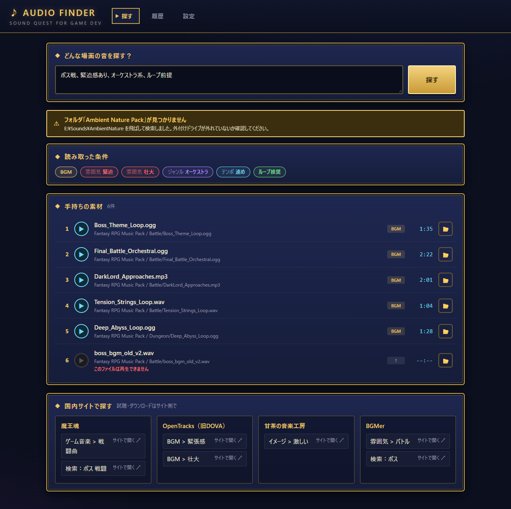
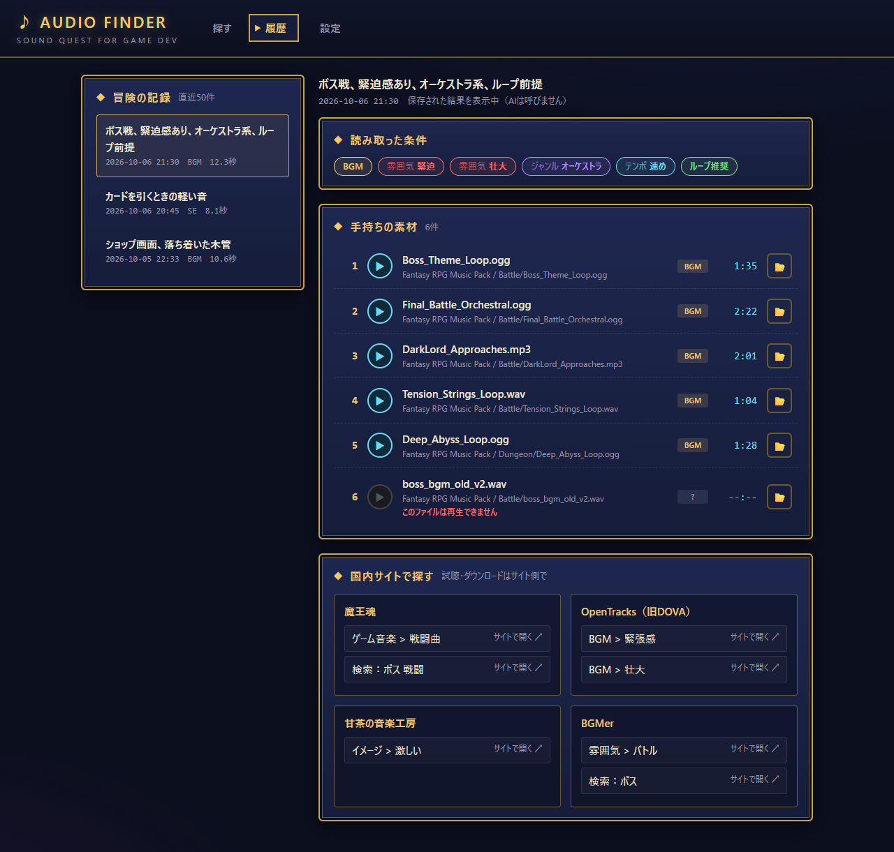
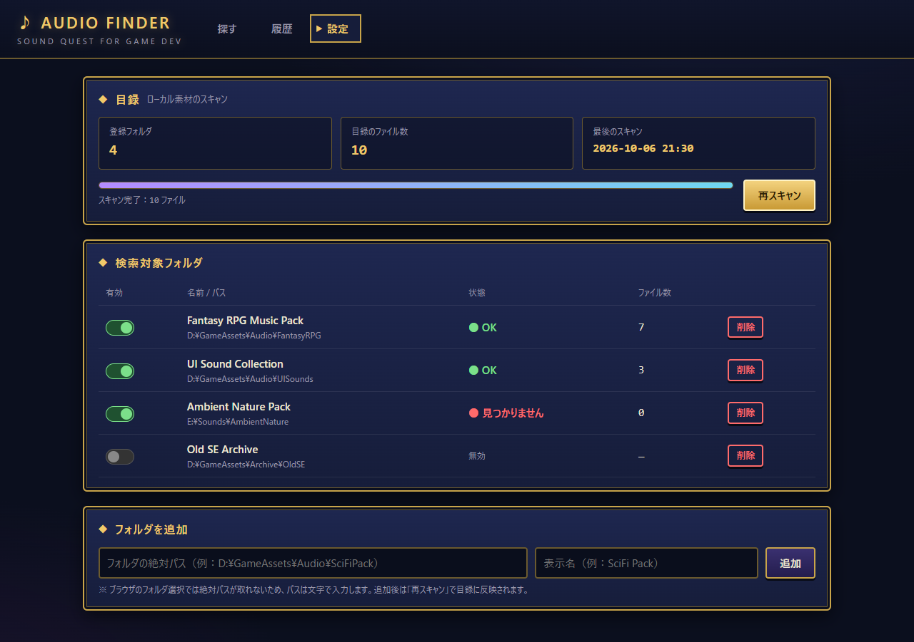

# Audio Finder

ゲーム制作で使うBGM・効果音（SE）を、「ボス戦、緊迫感あり、オーケストラ系、ループ前提」のような場面の説明から探す、自分のPCの中で動かすツールです。

> **個人用ツールのため、サポート・要望への対応はしません。** 不具合の報告や機能の要望をいただいても対応できません。自由に改造して使ってください（MITライセンス）。

1回の検索で、次の3つを表示します。

1. **読み取った条件**：AIが場面の説明をどう解釈したか（BGM／雰囲気／ジャンル／テンポ／ループ推奨）
2. **手持ちの素材**：登録したフォルダの中から合う候補（最大10件）。その場で試聴でき、エクスプローラーでも開けます
3. **国内サイトで探す**：魔王魂・効果音ラボ・OpenTracks（旧DOVA-SYNDROME）・甘茶の音楽工房・BGMer・OtoLogic・BGMusicの、カテゴリページやサイト内検索へのリンク（試聴やダウンロードはサイト側で行います）

詳しい仕様は [SPEC.md](SPEC.md) を見てください。

## 画面

ゲーム制作者向けのツールなので、RPGのウィンドウ風の見た目にしています。画像は、ダミーのデータと固定の答えを返すAIで動かした、実際のアプリの画面です。

**探す**：場面の説明から、読み取った条件・手持ちの素材・国内サイトの探し先を出す



**履歴**：過去の検索結果を、AIを呼ばずにすぐ見返せる（今の目録にないファイルは「見つかりません」になる）



**設定**：素材フォルダの登録と、目録の再スキャン



## 工夫した点

- **AIにURLを作らせない**：AIが返すのはサイトのIDとカテゴリID（または検索語）だけで、URLはサーバーが `sites.json` から組み立てます。存在しないページへのリンクが構造的に出ません
- **AIが返したIDは必ず検証する**：手持ちの素材は、目録に実在し、今も検索対象になっているフォルダのものだけを表示します。件数の上限（10件）もサーバー側で守ります
- **AIに渡す道具は読み取り専用だけ**：`claude -p` には、ファイルを読む・検索する・一覧する道具だけを許可しています。目録は丸ごと渡さず、AIが「1行＝1ファイル」の目録を自分で検索します
- **PC内のファイルを守る**：試聴やエクスプローラーで開く機能は、パスではなく目録のIDを受け取ります。登録フォルダの外には触らず、`../` のような要求は404にします。素材ファイルは読むだけで、書き換えません
- **国内サイトの規約を確認して設計**：サイトにはアクセスせず、リンクで案内するだけにしています。音源をAIに渡すこともしません（[SPEC.md](SPEC.md) 12章）
- **エラー時の動き**：未ログイン・利用上限・時間切れ・壊れた応答（1回だけ自動で再試行）・外付けドライブが外れているときを、それぞれ画面の帯で分かるようにしています

## 作り方

1. 仕様を決める：質問と回答で要件を詰め、[SPEC.md](SPEC.md) にまとめる。画面は先にモック（`mock/index.html`）を作って確定させる
2. 計画を立てる：[PLAN.md](PLAN.md) で9つのタスクに分け、それぞれに完了条件を決める
3. タスクごとにブランチを切って実装し、完了条件を自動テストと手での確認で確かめてから master にマージする
4. 仕上げとして、仕様と実装の違い・バグを洗い出して直す

自動テストは138件（pytest）です。AIの部分は決まった答えを返す偽物に差し替えて確かめるので、テストでは本物のAIを呼びません。

## 動作環境

| 項目 | 内容 |
|---|---|
| OS | Windows（`start.bat` での起動と、エクスプローラーで開く機能のため） |
| Python | 3.12 以上（3.14.8 で動作確認） |
| Claude Code | インストール済みであること（2.1.291 で動作確認） |
| Claude Console のAPIキー | 自分で発行したもの（下の「APIキーの設定」を参照） |
| ブラウザ | Edge・Chrome など、wav / mp3 / ogg を再生できるもの |

- AIの部分は、PCに入っている Claude Code（`claude -p`）を呼び出して動きます。`.env` に書いた**自分のAPIキー**で動き、**API利用料は各自の負担**になります
- サーバーは `127.0.0.1:8765` で待ち受けるので、自分のPCからしか開けません。このツールはPC内の音声ファイルを配信し、エクスプローラーを開くこともできるので、**`config.json` の `server.host` は `127.0.0.1` から変えないでください**（変えると、同じネットワークの他の端末から操作できてしまいます）

## インストール

1. Python 3.12 以上をインストールする
2. Claude Code をインストールする（公式の手順：https://code.claude.com/docs/en/setup）
3. このリポジトリを好きな場所に置く（`git clone` するか、ZIPでダウンロードして展開する）
4. 下の「APIキーの設定」をする

ライブラリ（fastapi・uvicorn・mutagen）は、初めて起動したときに自動で入ります。`requirements.txt` を書き換えたときも、次の起動時に自動で入れ直します。

## APIキーの設定

このツールは、各自が Claude Console で発行したAPIキーで動きます。**API利用料（従量課金）は、キーを発行した人の負担になります。** 1回の検索で、目録の検索とサイトの選択のためにAIを数回呼び出します。料金は Claude Console の「Usage」で確認できます。

1. Claude Console（https://platform.claude.com/）にアクセスし、アカウントを作ってログインする
2. 「Billing」で支払い方法を登録し、クレジットを購入する（クレジットがないとAPIは使えません）
3. 「API Keys」（https://platform.claude.com/settings/keys）で「Create Key」を押してキーを作り、表示された `sk-ant-` で始まる文字列をコピーする（キーは作ったときに一度しか表示されません）
4. このフォルダにある `.env.example` をコピーして、名前を `.env` に変える
5. `.env` をメモ帳などで開き、`ANTHROPIC_API_KEY=` の後ろをコピーしたキーに書き換えて保存する

```
ANTHROPIC_API_KEY=sk-ant-api03-（ここに自分のキー）
```

- `.env` は `.gitignore` に入っているので Git には入りません。**APIキーは人に見せたり、公開したりしないでください。** 漏れたときは、Claude Console ですぐにそのキーを削除してください
- 使いすぎが心配なときは、Claude Console の「Limits」で月の上限額を設定できます
- `.env` にキーがあるときは、Claude Code にログインしていても、ログイン中のアカウントではなく**APIキーで**動きます。`.env` を置かなければ、ログイン中の Claude Code のアカウントで動きます
- 作者は、自分の Claude Code のログインで使っています。APIキーでの動作は、キーが `claude -p` に渡り、無効なキーのときに認証エラーになるところまでを確認しています（有効なキーでの検索は、料金がかかるため試していません）

## 使い方

### 起動と終了

- **起動**：`start.bat` をダブルクリックします。ブラウザで `http://127.0.0.1:8765` が開きます
  - 初回だけ、`.venv`（仮想環境）を作ってライブラリを入れるので少し時間がかかります
- **終了**：黒いコンソールウィンドウを閉じます

### 1. 素材フォルダを登録する（設定画面）

1. メニューの「設定」を開く
2. 「フォルダを追加」に、素材が入っているフォルダの絶対パス（例：`D:\GameAssets\Audio\FantasyRPG`）と、表示名を入力して「追加」
   - ブラウザのフォルダ選択では絶対パスが取れないため、パスは文字で入力します。エクスプローラーのアドレスバーからコピーすると楽です
3. 「再スキャン」を押す。進行バーが最後まで進むと、目録ができます

- 対象の形式は wav / mp3 / ogg です。30秒以上のファイルにはBGM、短いファイルにはSEの印がつきます
- フォルダの中身を変えたときは、もう一度「再スキャン」を押してください（自動では更新しません）
- 一時的に検索から外したいフォルダは、「有効」のスイッチを切ります

### 2. 探す（探す画面）

1. 「どんな場面の音を探す？」に場面を書いて「探す」を押す（例：「カードを引くときの軽い音」「ショップ画面、落ち着いた木管」）
2. 20秒前後で結果が出ます（経過秒数が表示されます）
3. 手持ちの素材は ▶ で試聴、📂 でエクスプローラーを開いてそのファイルを選択した状態にできます
4. 国内サイトのリンクは新しいタブで開きます

候補が0件のときは「該当なし」と、言い換えの例が出ます。

### 3. 履歴を見る（履歴画面）

成功した検索は、新しい順に直近50件まで残ります。履歴の結果はAIを呼ばずにすぐ表示され、試聴や📂も使えます。
今の目録にないファイル（フォルダを外して再スキャンした、など）は、取り消し線と「見つかりません」の表示になります。

## うまくいかないとき

| 表示・症状 | 対処 |
|---|---|
| 「Claude Code の認証に失敗しました」 | `.env` のファイル名（`.env.example` のままになっていないか）と、`ANTHROPIC_API_KEY` の値が正しいか確認する。Claude Console でキーが削除されていないかも確認する |
| 「Claude Code が見つかりません」 | Claude Code をインストールする。インストール直後なら、`start.bat` を起動し直す |
| 「利用上限に達しました」 | APIのレート制限か、クレジット・月の上限額に達しています。Claude Console の「Billing」「Limits」を確認する |
| 「時間切れ」 | 「再試行」を押す。何度も出る場合は `data/config.json` の `ai.timeout_sec`（秒）を増やす |
| 「まだ目録がありません」 | 設定画面でフォルダを登録して「再スキャン」する |
| 黄色の「フォルダ「○○」が見つかりません」 | 外付けドライブが外れていないか確認する。そのフォルダだけ飛ばして検索は続きます |
| 「Python が見つかりません」「Python が古すぎます」（`start.bat`） | Python 3.12 以上をインストールしてから、もう一度起動する |
| 画面の見た目が古いまま | ブラウザで Ctrl+F5 を押して再読み込みする |

## データの保存場所

すべて `data/` の中のJSONファイルに保存します。テキストなので、壊れたときは手で直せます。

| ファイル | 中身 |
|---|---|
| `config.json` | 設定（登録フォルダ、AIの待ち時間、ポートなど）。初回起動時に自動で作られます |
| `index.json` | 目録（再スキャンで作り直されます） |
| `history.json` | 検索履歴（直近50件） |
| `sites.json` | 誘導先サイトとカテゴリの一覧。**手で編集します**（編集画面はありません） |

`config.json`・`index.json`・`history.json` は利用者ごとのデータなので、git では管理していません。

## 素材を使うときの注意

- サイトごとに利用規約が違います。素材を使う前に、各サイトの規約を確認してください
- **クレジット表記が必要なサイト**：魔王魂（例：`音楽：魔王魂`）、OtoLogic（CC BY 4.0）
- 規約の確認メモは [SPEC.md](SPEC.md) の12章にあります（2026-10-07時点）

## 開発者向け

- 構成：Python（FastAPI + uvicorn + mutagen）／画面は素のHTML・CSS・JavaScript（ビルドなし）／AIは `claude -p`（`.env` にAPIキーがあれば `--bare` を付け、APIキーだけで認証させる）
- テストの準備（初回だけ）：

```bash
.venv\Scripts\python -m pip install -r requirements-dev.txt
```

- テストの実行（`claude -p` は偽物に差し替えるので、本物は呼びません）：

```bash
.venv\Scripts\python -m pytest
```

- 作業の進め方は [CLAUDE.md](CLAUDE.md)、実装の順番と進み具合は [PLAN.md](PLAN.md) にあります

## ライセンス

[MIT License](LICENSE)
